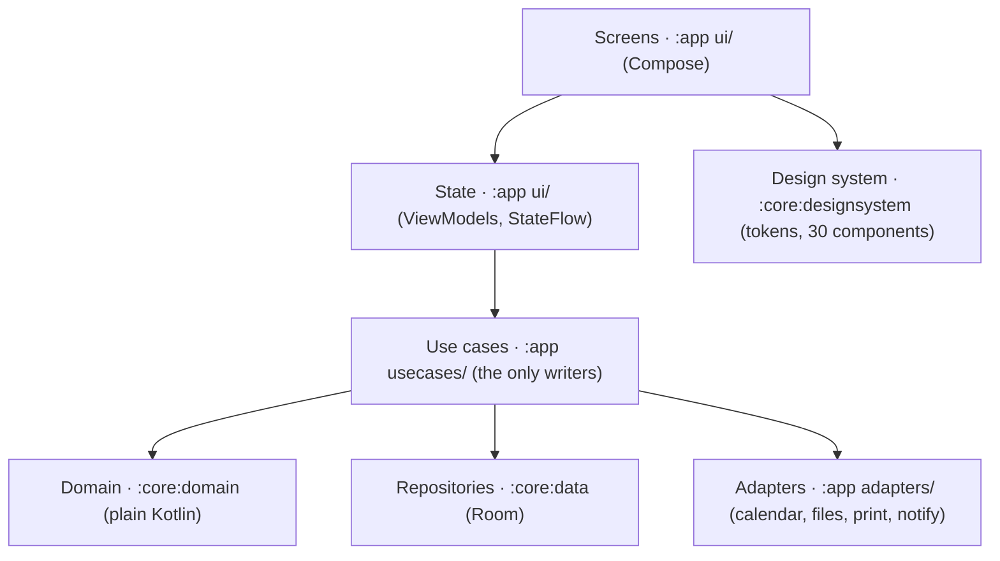

# Tutora v1 architecture and technology

Oct 27, 2026 · @Victor

## Recommendation

Decided with Victor on 27 Oct 2026: build Tutora as a **native Android app in Kotlin with Jetpack Compose**, data in SQLite through Room, and a domain core in plain Kotlin. iOS comes much later; the domain module and the main libraries are already Kotlin Multiplatform-ready, so iOS can share the rules (and possibly the UI) without a rewrite of the logic.

The first version (specs 001–005) was built with Expo + React Native and is archived at the `expo-final` tag and the `archive/expo` branch. Its specs, mockups, design tokens and lessons learned carry over; its code does not.

| Concern | Choice | Why |
| --- | --- | --- |
| Language | Kotlin (latest stable), JDK 21 toolchain, warnings as errors | One language from database to screen; the best Android tooling |
| UI | Jetpack Compose, Material 3 as the base layer under a Tutora theme built from our tokens | Declarative UI, previews, themes as data; Material 3 gives accessibility and motion for free, our tokens give the look |
| Navigation | Navigation Compose with type-safe routes: 5 tabs, each with its own back stack, plus full-screen routes | Mirrors the navigation map; typed arguments |
| Database | Room with exported schemas, `BundledSQLiteDriver` | First-party, compile-checked queries, Flow queries refresh screens by themselves; Room is KMP-capable |
| Async and state | Coroutines + Flow; `ViewModel` + `StateFlow` per screen | Lifecycle-aware, testable; lifecycle ViewModel is KMP-capable |
| Dependency wiring | A small hand-written `AppContainer` | No framework to learn or keep KMP-compatible; swap for Koin if it grows |
| Money | `Long` cents + an in-house money module in the domain | No floats; rounding lives in one tested file |
| Dates | `kotlinx-datetime`; instants stored as UTC ISO text | Time zones done right, KMP-ready, sortable in SQL |
| Serialization | `kotlinx.serialization` (JSON backups, typed routes) | One library for routes and backups, KMP-ready |
| i18n | String resources (`values/` English, `values-pt-rBR/` Portuguese) and `<plurals>`; per-app language through `AppCompatDelegate.setApplicationLocales` | The platform's own per-app language, no restart needed; a missing translation fails lint |
| Tests | JUnit + `kotest-property` (domain), Room on the JVM (data), Compose UI tests under Robolectric (screens), Roborazzi screenshots, Maestro end to end | Everything except Maestro runs on the computer with no emulator |
| Static analysis | Android Lint (warnings as errors), ktlint; detekt once it supports the Kotlin in use | Style, missing translations, and source checks for raw colors and domain purity |
| Build | Gradle with a version catalog; `./gradlew assembleRelease`, one signing key kept safe forever | Free, local; updates install over the old APK and keep data |

## Why native Kotlin now

The Expo version worked, but every native need (the live-timer notification, folder access for backups, calendar provider, fine control of the keyboard and sheets) went through a JS bridge, a config plugin or a third-party module, and each build and test cycle was slow. Tutora is Android-first for a long time, and Victor wants to build it the platform's own way.

| Option | Device features Tutora needs | Path to iOS | Main cost |
| --- | --- | --- | --- |
| **Native Kotlin + Compose (chosen)** | Everything directly: foreground service with a chronometer notification, `CalendarContract`, Storage Access Framework, WorkManager, `PdfDocument` | Kotlin Multiplatform: share the domain (and data with Room KMP); UI in Compose Multiplatform or SwiftUI | iOS is later work; the domain is shared from day one |
| Expo / React Native (archived) | Most through Expo modules; timer and folder writes needed native code anyway | Same code | Bridges, config plugins and slow builds for an Android-first app |
| Flutter | Community plugins for calendar, PDF, XLSX, background work | Same code | Dart; plugins from single maintainers |

## Architecture layers

Five layers with one rule: dependencies point down, and the domain imports nothing from Android, Compose or Room. Every money and scheduling rule is tested on the JVM in milliseconds.



A use case is the only place that writes: it loads rows through repositories, asks the domain what the new state is, writes it in one Room transaction, then calls adapters. Room's Flow queries emit again after the write, so every screen showing that data updates by itself; there is no invalidation map to maintain. Adapters sit behind small interfaces so tests swap them for fakes.

```text
settings.gradle.kts, gradle/libs.versions.toml
core/domain/              plain Kotlin (JVM now, commonMain later): money, pricing, places,
                          recurrence, schedule, fees, earnings, timer, backup schema
core/data/                Room database, entities, DAOs, migrations, repositories;
                          schemas/ holds the exported JSON schema of every version
core/designsystem/        TutoraTheme (generated tokens), typography, the 30 components
app/                      Application, MainActivity, AppContainer
  ui/                     one package per screen: Screen composable + ViewModel
    today/ schedule/ registry/ earnings/ settings/
    lesson/ live/ catalog/ setup/
  usecases/               ScheduleLesson, CompleteLesson, RecordPayment, RunBackup ...
  adapters/               calendar, files, print, notify
  res/                    values/strings.xml, values-pt-rBR/strings.xml, font/ (Nunito)
design/tokens.json        source of every color, type, spacing and radius token
docs/specs/               one folder per feature (see the SDD section)
.maestro/                 end-to-end flows
```

## State management and data flow

SQLite is the single source of truth; nothing in memory is authoritative except the second-by-second timer display.

| Kind | Where it lives | Examples | How it updates |
| --- | --- | --- | --- |
| Stored data | Room, read as `Flow` in repositories | Lessons of a day, a student's balance, earnings for a period | A use case writes; Room re-emits every Flow that reads those tables |
| App settings | `settings` table, exposed as one `Flow<Settings>` | Language, theme, custom colors, default places | Written by a use case; theme and language follow at once |
| Screen state | `ViewModel` `StateFlow`, `rememberSaveable` | Form drafts, open sheet, selected week | Local; survives rotation and process death where it matters |

Rules the specs assume:

1. **Aggregates in SQL.** Balances, earned vs expected and the 6-month trend come from SQL views and `GROUP BY` queries.
2. **Writes are use cases in one transaction** (`database.withTransaction`). A failure rolls everything back.
3. **Screens observe, never fetch.** A ViewModel combines repository Flows into one UI state; the Composable renders it and sends events back.
4. **Live timer = timestamps.** `{lessonId, startedAt, pausedMs, pausedAt}` lives in `lesson_timer` (`pausedMs` is the time in pauses that are over, `pausedAt` a pause in progress); the screen recomputes elapsed time and money each second from the clock. Killing the app loses nothing.
5. **Background work calls use cases directly.** WorkManager workers and notification actions use the same `AppContainer`, never ViewModels.

## Database schema and migrations

The data model and its rules carry over from the first version: the product doc's tables tightened as below. Every table has `id`, `created_at` and `updated_at`; money is integer cents; instants are UTC ISO 8601 text.

| Change from the product doc | Why |
| --- | --- |
| Ids are UUIDv7 text, not autoincrement | Stable across backup and restore, safe calendar event mapping, time-ordered |
| `lesson` has a CHECK that exactly one of `student_id` / `group_id` is set; same for `payment` payer | The database refuses impossible rows |
| Fee rule is columns on `place` and `student` with defaults in `settings` | One shape for default, custom and none |
| `lesson.is_detached` and `schedule_rule` split on "this and following" | Filling the next 8 weeks never overwrites a class changed by hand |
| `archived_at` on place, student and group\_class; removal for good only once archived | Arquivar keeps history; nothing disappears by accident |
| Built-in places have fixed ids, `builtin` set and no stored name; inserted at start-up when missing | Their names follow the app language |
| `calendar_link` (lesson\_id, calendar\_id, event\_id) instead of a column | Sync cleans up exactly what Tutora created |

Lessons learned in the first version, kept:

- A scheduled `lesson` stores no price. Its value is resolved on every read from the current prices, so price changes reach every class still on the schedule; only a value the teacher typed is kept. Marked done (spec 006), a class freezes the price it had in `rate_cents` / `rate_type`, and its travel, so its value no longer follows price changes but still recomputes when its duration is edited. Its real duration overwrites `planned_min`. A cancelled or missed class stores what happened in `cancel_reason` (student, no_show, teacher), the teacher's note in `cancel_note` and its charge in `fee_cents`, worked out once in the cancel sheet.
- `schedule_rule` keeps local `starts_on` / `ends_on`, `start_time`, `time_zone` and `generated_until`. `rule_skip` remembers dates removed with "Só esta aula". A unique `(rule_id, occurrence_date)` index makes filling idempotent. Filling runs at start-up and when the app returns to the foreground.

Balances stay computed (spec 008). When a class is done or charged, the use case freezes on it who owes it (`payer`), what it owes (`due_cents`: value plus travel, or the charge, or only travel for a package class) and the package it used, the same way it freezes the price. A balance query sums `due_cents` per payer minus payments. Which classes a payment paid is never stored: the domain's `allocate` works it out on each read from the payments in date order (classes chosen for a payment first, then oldest first, the rest as credit), so editing, deleting or undoing never leaves a stale "paid" mark.

Earnings (spec 009) are worked out in the domain, not stored: one query reads a period's done and charged classes with their place, and the domain applies the rules (commission off the class value, a package's price per class, the part a bonus covered, a school's salary per month), then sums earned, received (payments by date) and to receive (the ledgers' per-class `left`). A bonus is never money received.

**Migrations.** Room exports the schema JSON of every version into `core/data/schemas/`. Each new version adds a migration (an `AutoMigration` when Room can infer it, a written `Migration` otherwise), and `MigrationTestHelper` tests it on a database created at the previous version and seeded with typical rows. Before applying any pending migration the app copies the database file to `tutora-pre-v{n}.db`. The database runs in WAL mode with foreign keys on.

**Backup format.** The JSON backup keeps the product doc's shape (`app`, `schemaVersion`, `exportedAt`, `tables`), written with `kotlinx.serialization`. Restore upgrades older backups through a chain of pure functions in the domain, then replaces data in one transaction after copying the current database aside.

## Money and time

All arithmetic is integer, all rounding happens once at the end of a calculation, and every amount is integer cents of reais (constitution rules 8 and 9).

**Money rules**

- An amount is a `Long` of centavos. Arithmetic uses `Math.addExact` / `multiplyExact` so an overflow fails loudly instead of wrapping. Totals are exact sums of stored values.
- Rounding is half away from zero, applied once per result. Hourly lesson: `round(rate × minutes / 60)`. Commission in basis points: what you keep = `round(gross × (10000 − bp) / 10000)`.
- Price order: the class's own typed value, else the student's own price at the place, else the place's price; if the place pays, the place's rate. One function resolves it and says where the price came from.
- Formatting only at the edge (`NumberFormat` for `pt-BR` or `en-US`, always BRL), so the language changes how an amount is written, never the amount.
- Money fields fill from the right: the digits typed are the cents, up to R$ 99.999,99. Durations and times are typed as hh:mm the same way.
- Money uses tabular figures (`fontFeatureSettings = "tnum"`) so digits do not jitter.

**Time rules**

- Instants (`start_at`, `paid_at`, timer timestamps) are UTC ISO 8601 with milliseconds and `Z`, fixed width, so string order is time order.
- Recurring rules store wall-clock time plus the IANA zone; occurrences become instants with `kotlinx-datetime`, so "Tuesday 18:00" stays at 18:00 across daylight-saving changes.
- "Today", "this week" and report ranges are computed in the device zone and turned into a UTC `[from, to)` range for SQL.
- A `Clock` is injected everywhere time matters, so tests freeze it.

## Feature libraries

Every v1 feature maps to a platform API or a maintained library that works offline. Native Kotlin removes the two spikes the first version needed (timer notification, folder writes); one spike remains (**spike**).

| Feature | API or library | Approach | Watch out for |
| --- | --- | --- | --- |
| Live timer, in app | Compose + a 1 s ticker Flow | One composable recomposes per second from timestamps | Keep the counter in its own composable |
| Live timer, background | An ongoing notification (no foreground service, spec 007) using `setUsesChronometer` from the start minus pauses, with Pausar / Retomar through a `BroadcastReceiver` and Encerrar opening the app | The system ticks the chronometer with no app code running; elapsed time comes from timestamps, so nothing needs to stay alive. Re-posted on start-up after a reboot | On Android 14+ the user can swipe it away; the class stays live in the app |
| Reminders | `AlarmManager` (inexact) or WorkManager, `NotificationManager` | Next 8 weeks of lessons, rescheduled whenever lessons change; weekly "who owes you" | Inexact alarms can be minutes late; fine for reminders |
| PDF reports | `android.graphics.pdf.PdfDocument` drawn with Canvas, or an HTML template printed through `WebView` | Themed tables and the 6-month trend | Pagination for long ranges; test a 12-month report |
| XLSX export | A minimal hand-written XLSX writer (spec 010; no library) | Sheets per report; numbers as numbers, dates as dates | Check files open in Google Sheets and LibreOffice |
| Calendar sync | `CalendarContract` provider | A "Tutora – Aulas" calendar on the chosen account; a use case diffs the next 8 weeks against `calendar_link` | Never read events back as Tutora data |
| .ics export | Hand-written (plain text) | One VEVENT per lesson, UID = lesson id | Times in UTC |
| Backup and restore | `kotlinx.serialization`, Storage Access Framework, WorkManager periodic work | JSON to a folder picked once; keep the last N; catch up on open if a run was skipped | Whether Google Drive shows in the folder picker varies by device |
| Charts | Compose `Canvas` | Hand-drawn bars for two charts | A chart library is not worth it |
| Sheets, pickers | Material 3 `ModalBottomSheet`, our date sheet and hh:mm fields | Keyboard-aware sheets via `imePadding` | Test sheets with the keyboard open |
| Fonts | Nunito 400, 600, 700, 800 bundled in `res/font` | Set in the Tutora typography | None |

## Theming and i18n

Themes are data. `design/tokens.json` holds the eight token sets (four themes × light and dark), type styles, spacing, radius and sizes. A Gradle task generates `TutoraTokens.kt` from it; CI fails if the generated file is stale. `resolvePalette(theme, mode, systemScheme, customColors)` in the domain turns the teacher's choices into one palette (OKLCH lightening for dark mode, on-color picked by WCAG contrast), and `TutoraTheme` provides it through a `CompositionLocal`, so switching theme or painting a custom color recomposes with the new colors at once. Material 3's `ColorScheme` is filled from the same palette so Material components match. Components read `TutoraTheme.colors.primary`, never a raw `Color(0x…)`.

Large text scales the type styles only (×1.15); spacing never changes.

**Languages**

- Strings live in `values/strings.xml` (English) and `values-pt-rBR/strings.xml`; lint fails on a string missing from either. Plurals use `<plurals>` ("1 aula", "3 aulas").
- First run picks Portuguese for a Portuguese phone and English otherwise; afterwards the saved choice rules. The switch in Ajustes calls `AppCompatDelegate.setApplicationLocales`, which recreates the activity in the new language with no app restart.
- Money and dates are formatted with `NumberFormat` and `DateTimeFormatter` for the app language. The week starts on Monday in both languages.
- Built-in place names are string resources, so switching language renames them.

## Spec-driven development and testing

Each feature starts as a spec with numbered acceptance criteria, and each criterion becomes a test whose name carries its id. The specs written for the first version (001–005) stay valid: they describe the product, not the technology. Each is re-planned for Kotlin before being implemented again.

```text
docs/specs/
  constitution.md            non-negotiables
  001-foundation/            spec.md  plan.md  tasks.md
  002-design-system/
  ...
```

**Spec order** (each shippable on its own APK):

1. Foundation: Gradle project and modules, five tabs, default theme, both languages, Room + migrations, CI
2. Design system: tokens for 4 themes × light/dark, 30 components, custom colors, Large text
3. Money and language: R$ money rules, amount entry, language switch in Ajustes
4. Places and students: built-in places, CRUD, student–place links, price resolution, archive
5. Schedule: recurring and one-off classes, 8 weeks ahead, this-only vs this-and-following, Agenda and Hoje
6. Lessons: log a past lesson, mark done, status changes, cancellation and no-show fees
7. Live timer: timestamps, pause and resume, foreground notification
8. Payments and packages
9. Earnings dashboard
10. Reports: PDF, XLSX, copy as text
11. Backup: manual JSON and restore, automatic backup to a folder
12. Calendar sync and .ics
13. Appearance screens: theme picker, Suas cores, text size
14. Reminders and first-run setup

**Testing pyramid**

| Level | Tool | What it covers | Runs |
| --- | --- | --- | --- |
| Domain | JUnit + `kotest-property` on the JVM | Money, pricing, recurrence, fees, timer math, palette and contrast | Every save, seconds |
| Data | Room with the bundled SQLite driver on the JVM, `MigrationTestHelper` | Migrations from every past version, DAOs and views, backup upgrade chain | Every commit |
| Screens | Compose UI tests under Robolectric; Roborazzi screenshots (Large text, both themes) | Forms, Hoje, Agenda, Cadastro, both languages | Every commit |
| End to end | Maestro flows on an emulator | Tab tour, add a recurring class, log a lesson, timer, payment | Before a release, or when Victor asks |

Adapters are interfaces with in-memory fakes, so use cases are tested without a device. Tests are lean: one focused test per criterion.

## Build and sideload

Build a signed release APK locally and install it over the previous one; the signing key must never be lost, because a different key forces an uninstall, which deletes every lesson on the phone.

1. Day to day: `./gradlew installDebug` on the emulator or the phone, or Run from Android Studio.
2. Release: `./gradlew assembleRelease`, signing from `TUTORA_KEYSTORE_*` environment variables; `versionCode` from `TUTORA_VERSION_CODE`. Development builds use a throwaway keystore kept outside the repo.
3. Versioning: `versionName` follows the last spec shipped; Ajustes › Sobre shows the version, build and schema version.
4. The Kotlin app uses a new application id from the Expo app's, so the two can live side by side; the Expo app's test data is not migrated (Victor, 27 Oct 2026).
5. Android developer verification: confirm the current sideloading rules before the first release; `adb` install or a free limited-distribution account cover it.

**iOS, much later.** Move `:core:domain` to a Kotlin Multiplatform module (`commonMain`), make `:core:data` multiplatform with Room KMP, and build the UI either in Compose Multiplatform or SwiftUI. Platform pieces (timer notification, calendar, files) get iOS implementations behind the same adapter interfaces.

**Performance budget** (constitution rule 18): cold start to Hoje under 1.5 s, tab switch under 300 ms with a year of data, lists at 60 fps. Baseline profiles help cold start; indexed SQL aggregates keep tabs fast.

## Risks

- **Rebuilding 001–005.** The specs and lessons carry over, so the rebuild is faster than the first pass; each spec still ships on its own PR and APK.
- **XLSX on Android.** Settled in spec 010 with a minimal writer of our own; it still needs checking in Google Sheets and LibreOffice on a device.
- **Auto-backup into Google Drive** through the folder picker varies by phone. Fallbacks: a local folder plus a sync app, or a reminder that opens the share sheet.
- **Battery savers** delay background work. The app catches up on every open and warns after 14 days without a backup.
- **Losing the signing key** means the next install wipes data. Back it up on day one.
