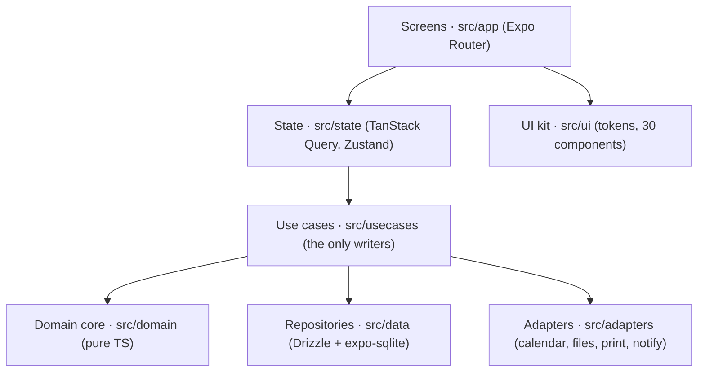

# Tutora v1 architecture and technology

Oct 26, 2026 · @Victor

## Recommendation

Decided with Victor on 26 Oct 2026: build Tutora v1 with **Expo (React Native) in TypeScript, styled with Tailwind through NativeWind, SQLite through Drizzle ORM, and a pure TypeScript domain core**. It covers every v1 requirement with maintained, offline libraries, ships as a sideloaded APK today, and becomes an iOS build later without a rewrite. The two places where Expo alone is not enough (the live-timer notification and auto-backup into a cloud folder) are small and isolated, and both get a spike before the specs that depend on them.

| Concern | Choice | Why |
| --- | --- | --- |
| Framework | Expo SDK (latest stable when the repo is created), New Architecture, Hermes | One codebase for Android and iOS, Expo modules cover calendar, files, print, notifications, background work |
| Language | TypeScript, `strict` | Shared types from DB row to screen; the domain core is testable without a phone |
| Styling | Tailwind CSS through NativeWind, theme colors as CSS variables | Tailwind classes you already know; runtime themes and custom colors by swapping variables |
| Navigation | Expo Router (file based), 5 tabs + stacks + a full-screen live lesson route | Mirrors the navigation map in the mockups one to one |
| Database | `expo-sqlite` + Drizzle ORM, SQL migrations generated by `drizzle-kit` | Typed queries, plain SQL files for migrations, WAL mode, fast |
| Server state | TanStack Query over a repository layer | Caching, invalidation after writes, loading states for free |
| UI state | Zustand (settings, theme, live timer session) | Tiny, no boilerplate, readable outside React (notifications, tasks) |
| Forms | React Hook Form + Zod | Same Zod schemas validate forms and JSON backups |
| Money | Integer minor units + a small in-house `Money` module | No floats anywhere; rounding rules live in one tested file |
| Dates | `date-fns` v4 + `@date-fns/tz`, instants stored as UTC ISO text | Correct local days and months, sortable in SQL |
| Lists, motion | FlashList, Reanimated, Gesture Handler, `@gorhom/bottom-sheet` | Smooth scrolling, drag to reschedule, sheets for pickers |
| i18n | i18next + react-i18next + `expo-localization`, `Intl` for numbers and dates | pt-BR and EN string files with typed keys |
| Reports | `expo-print` (HTML to PDF), SheetJS (XLSX), `ics` (.ics), `expo-sharing` | All offline, no backend |
| Device | `expo-calendar`, `expo-file-system`, `expo-document-picker`, `expo-notifications`, `expo-background-task` | One-way calendar sync, files, reminders, scheduled backups |
| Tests | Jest (`jest-expo`) + React Native Testing Library, `fast-check`, Maestro for end to end | Domain rules proven in milliseconds, real flows proven on an emulator |
| Build | Local `gradlew assembleRelease` (or EAS Build `preview` profile), one signing key kept safe forever | Free, no store, updates install over the old APK and keep data |

The product doc already leaned this way; this document turns it into decisions, a schema and the rules each spec will be written against.

## Stack comparison

Expo wins on ecosystem fit for this app's device features and on the path to iOS; Flutter is the only close second and would be the pick if you already write Dart. Native Kotlin is the fastest Android result but doubles the work for iOS, and a web app cannot reach the calendar store or background tasks.

| Option | Device features Tutora needs | Path to iOS | Performance for this app | Main cost |
| --- | --- | --- | --- | --- |
| **Expo / React Native (recommended)** | First-party modules for SQLite, calendar, print, files, notifications, background tasks; SheetJS runs in JS | Same code, iOS build later | Native views, Hermes; 60 fps lists with FlashList; timer is a 1 s re-render of one component | Two native gaps (timer notification, cloud folder writes) need a small Kotlin module or a library |
| Flutter (Dart) | `sqflite`/Drift, `device_calendar`, `pdf`, `excel`, `workmanager`, `flutter_local_notifications`, all community plugins | Same code | Excellent; own renderer, very consistent | Dart only; more plugins from single maintainers; theming and i18n equally good |
| Native Kotlin + Compose | Everything, directly | Rewrite in Swift, or move to Kotlin Multiplatform | Best on Android | iOS is a second app; slower to iterate |
| Kotlin Multiplatform + Compose MP | Shared logic, UI shared on iOS too | Good, Compose on iOS is stable | Very good | Smaller ecosystem for calendar, PDF and XLSX; you would write more platform code |
| PWA (web app) | No calendar store, no reliable background work, file access limited | Works in Safari with limits | Fine | Fails the calendar sync and auto-backup requirements |

What tips it to Expo: the product doc's calendar approach (write into the phone's own calendar store so Google or Outlook syncs it) maps to `expo-calendar` with no extra code, and `expo-print` turns the same HTML template into the report PDF on both platforms. In Flutter those are third-party plugins; in Expo they are maintained with each SDK release.

## Architecture layers

Five layers with one rule: dependencies point down, and the domain core imports nothing from React, Expo or SQLite. That keeps every money and scheduling rule testable in Node in milliseconds, which is what makes spec-driven development cheap here.



A use case is the only place that writes: it loads rows through repositories, asks the domain core what the new state is, writes it in one SQLite transaction, then tells adapters (calendar, notifications) and invalidates the affected queries. Adapters sit behind small TypeScript interfaces so tests swap them for fakes.

```text
src/
  app/                    Expo Router routes (screens only)
    (tabs)/today, schedule, students, places, earnings
    lesson/[id].tsx, lesson/[id]/edit.tsx, lesson/new.tsx
    live/[lessonId].tsx   full-screen live lesson
    settings/...          appearance, colors, calendar, backup, fees
    setup/...             first-run, 4 steps
  domain/                 pure TS: money.ts, pricing.ts, fees.ts, recurrence.ts,
                          earnings.ts, timer.ts, backup-schema.ts
  usecases/               completeLesson.ts, recordPayment.ts, runBackup.ts ...
  data/
    schema.ts             Drizzle tables and views
    migrations/           generated SQL + meta (bundled)
    repos/                lessonRepo.ts, studentRepo.ts, placeRepo.ts ...
  adapters/               calendar.ts, files.ts, print.ts, notify.ts
  state/                  query keys and hooks, zustand stores
  ui/                     theme/, components/, charts/
  i18n/                   pt-BR.json, en.json, index.ts
modules/live-timer/       local Expo module (Kotlin) for the ongoing notification
docs/specs/               one folder per feature (see SDD section)
```

## State management and data flow

SQLite is the single source of truth; nothing in memory is authoritative except the second-by-second timer display. State splits three ways:

| Kind | Where it lives | Examples | How it updates |
| --- | --- | --- | --- |
| Stored data | SQLite, read through TanStack Query | Lessons of a day, student balance, earnings for a period | Use case writes, then invalidates keys by table (`['lessons', …]`, `['balances', …]`) |
| App settings | `settings` table, mirrored in a Zustand store at start-up | Language, theme, custom colors | Store action writes SQLite first, then updates the store; theme and language switch instantly |
| Screen state | Component state, React Hook Form | Form drafts, open sheet, selected week | Local; never persisted except the add-lesson draft if the app is killed |

Rules the specs will assume:

1. **Aggregates in SQL, not JS.** Balances, earned vs expected and the 6-month trend come from SQL views and `GROUP BY` queries, so Today and Earnings open instantly even with years of lessons.
2. **Writes are use cases in one transaction.** `completeLesson` sets status, final minutes and `earned_cents`, applies a package credit, then updates the calendar event after commit. A failure rolls everything back.
3. **Invalidation by table.** A tiny map from table to query-key prefixes (lesson → lessons, balances, earnings, today) keeps every screen consistent after any write, without a global reload.
4. **Live timer = timestamps.** The store holds `{lessonId, startedAt, pausedMs, lastResumeAt}` copied from `lesson_timer`; the screen recomputes `elapsed` and money each second with a 1 s interval aligned to the clock. Killing the app loses nothing.
5. **Background is a separate entry point.** The backup task and notification actions run without React, so they call use cases directly, never hooks.

Why not Redux or MobX: there is almost no client-only state to manage, and the cache plus a small store is less code. Why not Drizzle's `useLiveQuery` alone: it is a good fit for simple lists and can be used there, but TanStack Query handles the aggregate queries, loading states and prefetching (next week on the Agenda) more cleanly.

## Database schema and migrations

Keep the product doc's data model and tighten it in seven ways so restore and sync stay safe. Every table gets `id`, `created_at` and `updated_at`; money is integer cents; instants are UTC ISO 8601 text.

| Change from the product doc | Why |
| --- | --- |
| Ids are UUIDv7 text, not autoincrement | Stable across backup and restore, safe calendar event mapping, time-ordered so indexes stay fast |
| `lesson` has a CHECK that exactly one of `student_id` / `group_id` is set; same for `payment` payer | The database refuses impossible rows, not just the UI |
| Fee rule is columns on `place` and `student` (`fee_mode`, `fee_window_h`, `late_fee_kind`, `late_fee_value`, `no_show_fee_kind`, `no_show_fee_value`) with defaults in `settings` | One shape for default, custom and none; the domain resolves it |
| `lesson.is_detached` (edited on its own) and `schedule_rule` split on "this and following" | Regenerating the next 8 weeks never overwrites a class you changed by hand |
| `archived_at` on place, student and group\_class; removal for good only once archived, cascading links, groups and members (spec 004) | Arquivar keeps history; nothing disappears by accident |
| Built-in places have fixed ids and `builtin` set, no stored name, and are inserted at start-up when missing | Their names follow the app language; restore and sync always find them |
| `calendar_link` (lesson\_id, calendar\_id, event\_id) instead of a column | Re-targeting the calendar or turning sync off cleans up exactly what Tutora created |

Core of the `lesson` table, as the migration will create it:

```sql
CREATE TABLE lesson (
  id               TEXT PRIMARY KEY,           -- UUIDv7
  rule_id          TEXT REFERENCES schedule_rule(id) ON DELETE SET NULL,
  student_id       TEXT REFERENCES student(id),
  group_id         TEXT REFERENCES group_class(id),
  place_id         TEXT NOT NULL REFERENCES place(id),
  start_at         TEXT NOT NULL,              -- '2026-10-26T20:40:00.000Z'
  planned_min      INTEGER NOT NULL,
  actual_min       INTEGER,                    -- set when done
  status           TEXT NOT NULL CHECK (status IN ('scheduled','live','done','cancelled','missed')),
  rate_type        TEXT NOT NULL CHECK (rate_type IN ('hour','lesson','package')),
  rate_cents       INTEGER NOT NULL,
  commission_bp    INTEGER NOT NULL DEFAULT 0, -- basis points, 30% = 3000
  earned_cents     INTEGER,                    -- snapshot when done / fee kept
  travel_fee_cents INTEGER NOT NULL DEFAULT 0,
  fee_cents        INTEGER NOT NULL DEFAULT 0,
  fee_waived       INTEGER NOT NULL DEFAULT 0,
  package_id       TEXT REFERENCES package(id),
  source           TEXT NOT NULL CHECK (source IN ('manual','timer','schedule')),
  is_detached      INTEGER NOT NULL DEFAULT 0,
  notes            TEXT,
  created_at TEXT NOT NULL, updated_at TEXT NOT NULL,
  CHECK ((student_id IS NULL) <> (group_id IS NULL))
);
CREATE INDEX lesson_start ON lesson(start_at);
CREATE INDEX lesson_student_start ON lesson(student_id, start_at);
CREATE INDEX lesson_place_start ON lesson(place_id, start_at);
```

**As built in spec 005.**
- A scheduled `lesson` stores no `rate_type` / `rate_cents`. Its value is resolved on every read from the current prices (`lessonWorth`), so price changes reach every class still on the schedule. Only a value the teacher typed (`value_cents`) is kept. 006 adds `actual_min`, `earned_cents`, fees and the full status set, and freezes the value when a class is done.
- `schedule_rule` keeps `starts_on` / `ends_on` (local dates), `start_time`, `time_zone` and `generated_until`. `rule_skip` remembers dates removed with "Só esta aula". A unique `(rule_id, occurrence_date)` index makes filling idempotent.
- Filling runs at start-up and whenever the app returns to the foreground.

Balances stay computed, never stored: a `v_balance` view sums `earned_cents + travel + kept fees` on done, cancelled-with-fee and missed lessons per payer, minus `payment` amounts, all in reais.

**Migrations.** Drizzle schema in `data/schema.ts` is the source; `drizzle-kit generate` writes numbered SQL files that are bundled with the app and applied at start-up before the first screen renders, tracked in Drizzle's migrations table. Rules: migrations only go forward; each is tested against a seeded database of the previous version; before applying any pending migration the app copies the database file to `tutora-pre-v{n}.db` so a bad update is recoverable. The start-up also sets `PRAGMA journal_mode=WAL` and `foreign_keys=ON`.

**Backup format.** The JSON backup keeps the doc's shape (`app`, `schemaVersion`, `exportedAt`, `tables`). Restore validates it with Zod, upgrades it through a chain of pure functions (`v1→v2→…`) to the current version, then replaces data in one transaction after copying the current database file aside. The same upgrade chain is tested with fixture backups from every released version.

## Money and time

All arithmetic is integer, all rounding happens once at the end of a calculation, and every amount is integer cents of reais (v1 has no other currency, constitution rule 9). These rules go into `domain/money.ts` and are the first spec written.

**Money rules**

- An amount is `Cents`, a safe integer of centavos; it stays well inside JavaScript's safe integer range, so no decimal library is needed (BigInt is used only inside the rounding step). Totals are exact sums of stored values (`sum`).
- Rounding is half away from zero, applied once per result, never per step. Hourly lesson: `lessonValue(rate, 'hour', minutes)` = `round(rate_cents × minutes / 60)`.
- Commission is basis points: what you keep = `round(gross × (10000 − commission_bp) / 10000)`. A 30% salinha cut on R$ 100/h for 60 min keeps R$ 70,00.
- Price order (product doc): lesson override, else `student_place.rate_cents`, else the place default. One function, `resolvePrice()`, returns the value and where it came from, so Edit class can show "from Salinha Centro".
- Cancellation fee: `resolveFeeRule(student, place, settings)` then `feeFor(lesson, status, cancelledAt)`; the hours-of-notice comparison uses instants, not local clock times.
- Formatting only at the edge, with `formatMoney` in `ui/format.ts` (`Intl.NumberFormat(locale, {style:'currency', currency:'BRL'})`), so the language changes how an amount is written, never the amount.
- Money fields fill from the right: the digits of the formatted text are the cents (`typedCents`), up to R$ 99.999,99.
- Live counter uses `fontVariant: ['tabular-nums']` with Nunito so digits do not jitter.

**Time rules**

- Instants (`start_at`, `paid_at`, timer timestamps) are UTC ISO 8601 with milliseconds and `Z`, fixed width, so string order is time order and indexes work.
- Recurring rules store wall-clock time plus the IANA zone (`America/Sao_Paulo`); lessons are generated by converting each local occurrence to UTC with `@date-fns/tz`. A teacher in a DST zone keeps "Tuesday 18:00" all year.
- "Today", "this month" and report ranges are computed in the device zone, then turned into a UTC `[from, to)` range for SQL. The end is always exclusive.
- Timer: `elapsed = (lastResumeAt ? now − lastResumeAt : 0) + accumulatedMs`, from stored timestamps; money is derived from elapsed on every tick and written to `earned_cents` only when the lesson stops. The phone restarting mid-lesson changes nothing.
- The `Date` clock is the only time source in the app and is injected into the domain as `now()`, so tests freeze it.

## Feature libraries

Every v1 feature maps to a maintained library that works offline; two need a spike on a real phone before their spec is final (marked **spike**).

| Feature | Library | Approach | Watch out for |
| --- | --- | --- | --- |
| Live timer, in app | Reanimated + a 1 s interval | One component re-renders per second from timestamps; nothing else on screen re-renders | Keep the counter in its own component so lists below it do not re-render |
| Live timer, background (**spike**) | Local Expo module in Kotlin (`modules/live-timer`), or Notifee | Ongoing notification using Android's built-in chronometer, so elapsed time ticks with no JS running; money shown as "R$ 2,00/min" and the total at pause or stop; Pause and Stop actions | JS cannot update a notification every second in the background; the native chronometer is the reliable way. Needs `POST_NOTIFICATIONS` |
| Reminders | `expo-notifications` | Local scheduled notifications for the next 8 weeks of lessons, rescheduled whenever lessons change; weekly "who owes you" summary | Android may deliver inexact alarms a few minutes late; fine for reminders |
| PDF reports | `expo-print` + `expo-sharing` | HTML template (themed main color, tables, 6-month trend as inline SVG) rendered to PDF, then the share sheet | Long ranges paginate with CSS `page-break-inside: avoid` on rows; test a 12-month report |
| XLSX export | SheetJS (installed from the SheetJS CDN tarball, not the stale npm `xlsx`) | Sheets: lessons, payments, students, places, monthly summary; numbers as numbers with currency number formats; written with `expo-file-system` | Community edition does not style cells (bold, fills); if headers must be styled, `xlsx-js-style` is the drop-in fork |
| Calendar sync | `expo-calendar` | Create a "Tutora – Aulas" calendar on the chosen account; a `syncCalendar` use case diffs the next 8 weeks against `calendar_link` and creates, updates or deletes events; busy-time reads other calendars' events for the Agenda | Event fields stay in the device language; never read events back as Tutora data |
| .ics export | `ics` (pure JS) | One VEVENT per lesson in the chosen range, UID = lesson id, shared via the share sheet | Times written in UTC to avoid zone mistakes in other apps |
| Manual backup and restore | `expo-file-system`, `expo-document-picker`, `expo-sharing` | JSON written to the cache, then shared; restore picks a `.json` file | Large backups: stream table by table instead of one giant string |
| Automatic backup (**spike**) | `expo-background-task` + folder access through Android's folder picker (Storage Access Framework) in `expo-file-system` | Daily, weekly or monthly task writes `tutora-YYYY-MM-DD.json`, keeps the last N, records `last_backup_at`; the app catches up on open if Android skipped a run | Whether Google Drive appears in Android's folder picker varies by device and Drive version; if it does not, fall back to a local folder that a sync app watches, or to OneDrive / Dropbox if their pickers allow it. Some phone brands (Xiaomi, Samsung) delay background work |
| Charts in the app | `react-native-svg` | Hand-drawn bars for the 6-month trend and the earned vs received bar | A chart library is not worth it for two charts |
| Pickers, sheets, gestures | `@gorhom/bottom-sheet`, `react-native-gesture-handler`, `@react-native-community/datetimepicker` | Bottom sheets for student and place pickers; long-press and drag to move a class on the Agenda | Drag to reschedule is the most gesture-heavy screen; prototype early |
| Lists | `@shopify/flash-list` | Students, lessons and report lists | None at this data size |
| Fonts | `@expo-google-fonts/nunito` + `expo-font` | Nunito 400, 600, 700, 800 bundled | Load before hiding the splash screen |

## Theming and i18n

Styling is Tailwind through NativeWind, and themes are data: every color class (`bg-primary`, `text-earnings`) points at a CSS variable, and the active palette is computed once per change from theme + mode + custom colors, then set as those variables at the app root. Switching theme or painting a custom color changes variables, not class names. No UI kit is needed; the mockups' components are simple enough to own.

**Theme pipeline**

1. `themes.ts` holds the four themes (Quadro-negro, Caderno azul, Biblioteca, Giz pastel), each with `light` and `dark` token sets: `primary`, `accent`, `secondary`, `background`, `surface`, `text`, `textMuted`, plus fixed `success` and `danger` that custom colors never change.
2. Custom colors are a map keyed by the seven editable parts from the Suas cores screen (`header`, `primaryBtn`, `highlightBtn`, `earnings`, `background`, `cards`, `activeTab`). Parts default to the theme token they came from.
3. `resolvePalette(theme, mode, systemScheme, custom)` is a pure function: picks the mode, applies overrides, lightens custom colors for dark mode in OKLCH (about 40%, per the product doc), and picks white or ink text for each colored surface by WCAG contrast. `culori` handles OKLCH and contrast.
4. `tailwind.config.js` declares the semantic colors as variables (`primary: 'rgb(var(--color-primary) / <alpha-value>)'`, one per token and per editable part, `on-primary` for the auto text color). A root `ThemeProvider` applies the resolved palette with NativeWind's `vars()`, so every `className` picks it up at once with no restart.
5. Components are written with classes (`className="rounded-2xl bg-surface p-4"`), with a `cn()` helper (`clsx` + `tailwind-merge`) and `tailwind-variants` for buttons and chips. Nunito is set as `font-sans`; money uses `tabular-nums`. The Large text option scales the type tokens; how it hooks into NativeWind's rem setting is checked in spec 001.
6. The PDF template does not use Tailwind; it receives the same resolved palette as hex values, so reports match the app.

Version note: NativeWind v4 runs on Tailwind CSS v3 and is the stable choice today; v5 targets Tailwind v4. Spec 001 pins whichever is stable on the Expo SDK in use when the repo is created.

**Languages**

- `i18next` + `react-i18next`, with `pt-BR.json` and `en.json` and TypeScript-typed keys, so a missing translation fails the type check.
- First run reads the phone's language with `expo-localization`; after that the `language` setting rules. Changing it never changes an amount.
- Plurals through i18next's `Intl.PluralRules` support ("1 aula", "3 aulas"); dates with `Intl.DateTimeFormat` and `date-fns` locales (`ptBR`, `enUS`); money with `Intl.NumberFormat`. Hermes on Android ships the needed `Intl` APIs; a test renders every formatter in both locales on the emulator once.
- The XLSX and PDF use the app language for headers and reais for totals, as the product doc says.
- Built-in place names (Casa do Aluno, Online / Remoto) are stored as keys and translated at display time, so switching language renames them.

## Spec-driven development and testing

Each feature starts as a spec with numbered acceptance criteria, and each criterion becomes at least one test before the code is written. The repo carries the specs, so Claude Code (or you) can implement one spec per branch and PR.

**Repo layout for specs** (compatible with GitHub Spec Kit if you want its commands, but it works as plain Markdown):

```text
docs/specs/
  constitution.md            non-negotiables: offline, integer money, UTC instants,
                             domain imports nothing, every criterion has a test
  001-foundation/            spec.md  plan.md  tasks.md
  002-design-system/
  003-money-and-language/
  ...
```

- `spec.md`: user stories and acceptance criteria in Given / When / Then, with ids (`AC-003-4`). No technology in it.
- `plan.md`: the layers, tables, use cases and screens touched; links to the mockup artboard.
- `tasks.md`: ordered checklist; each task names the test file that proves it. Test names carry the criterion id, so a grep shows coverage.

**Suggested spec order** (each one shippable on its own APK):

1. Foundation: Expo app, router with 5 empty tabs, theme tokens, i18n, SQLite + migrations, CI
2. Design system: tokens for 4 themes × light/dark, 30 shared components, custom colors, Large text (code in `src/ui`, documented in [`docs/design-system/`](design-system/), published as the [Tutora Design System](https://claude.ai/artifact/VqkNrENr4qcTcuDvqYwPei))
3. Money and language: R$ money rules, amount entry, language switch in Ajustes
4. Places and students: built-in places, CRUD, student–place links, price resolution
5. Schedule: recurring rules, 8-week generation, this-only vs this-and-following edits, Agenda and Today
6. Lessons: add, log a past lesson, mark done, edit, status changes, cancellation and no-show fees
7. Live timer: timestamps, pause and resume, background notification (after the spike)
8. Payments and packages: record payment, covered lessons, balances view
9. Earnings dashboard: period and type filters, 6-month trend
10. Reports: per student or place, PDF, XLSX, copy as text
11. Backup: manual JSON and restore, automatic backup to a folder (after the spike)
12. Calendar sync and .ics
13. Appearance screens: theme picker, Suas cores, text size (built on spec 2)
14. Reminders and first-run setup

**Testing pyramid**

| Level | Tool | What it covers | Runs |
| --- | --- | --- | --- |
| Domain unit | Jest + `fast-check` property tests | Money, pricing, fees, recurrence, timer math, palette and contrast; properties such as "a total is the exact sum of its lessons" | Every save, under 5 s |
| Data | Jest + `better-sqlite3` in Node running the same migration SQL | Migrations from every past version, views (`v_balance`), repository queries, backup upgrade chain with fixture files | Every commit |
| Components | React Native Testing Library | Forms (value computed as you type), Today, Earnings with seeded data, both languages | Every commit |
| End to end | Maestro YAML flows on an Android emulator | First-run setup, add recurring class, log a lesson, live timer start/pause/stop, record payment, export PDF | Before each APK release |

Adapters (calendar, files, print, notifications) are interfaces with in-memory fakes, so use cases are tested without a device. CI on GitHub Actions runs type check, ESLint, and the first three levels on every PR once the repo is linked.

## Build and sideload

Build a signed release APK locally and install it over the previous one; the signing key is the one thing that must never be lost, because a different key forces an uninstall, which deletes every lesson on the phone.

**Android, v1**

1. Day to day: `npx expo run:android` with a development build (`expo-dev-client`). Expo Go is not enough once the local timer module exists.
2. Release: `npx expo prebuild` then `./gradlew assembleRelease` (free, on your machine), or EAS Build with a `preview` profile set to `buildType: "apk"` if you prefer cloud builds. Both produce the same signed APK.
3. Signing: generate one upload keystore, store it and its passwords outside the repo (password manager plus an offline copy). Same key + higher `versionCode` = update in place, data kept.
4. Install: send the APK to the phone (Drive, USB, `adb install -r`), allow "install unknown apps" for the app that opens it.
5. Versioning: `version` follows the spec number shipped (`1.4.0` = spec 4 done); `versionCode` increments every build. A Settings › About row shows both plus the schema version.
6. Safety net: before installing a new APK, the app's own auto-backup has a fresh JSON; the pre-migration database copy covers the rest.

**Android developer verification (check before release).** Google announced in 2025 that, from September 2026 in Brazil and a few other countries, apps installed on certified Android phones must come from a registered developer, sideloading included, with a free limited-distribution option for personal and student use and an exemption for installs over `adb`. This is from memory of the announcement, not checked today, so confirm the current rules when the first APK is ready; worst case, register the free account or install with `adb`.

**Optional: over-the-air JS updates.** `expo-updates` with EAS Update can push JS-only fixes without a new APK. Not needed for a single-user app in v1; worth it later if friends start using Tutora.

**iOS, later.** The same code builds for iOS, but installing outside the App Store needs an Apple Developer account (US$ 99 per year) for TestFlight or ad hoc installs; a free account works with apps re-signed every 7 days. The Kotlin timer module needs a Swift twin (or Notifee, which covers both), and auto-backup uses the iOS Files folder picker instead of Android's.

**Performance budget** (checked on a mid-range Android before each release): cold start to Today under 1.5 s, any tab under 300 ms with a year of data, Agenda scroll at 60 fps, live counter tick with no dropped frames. Hermes, the New Architecture, indexed SQL aggregates and FlashList are what make these realistic.

## Decisions for Victor and risks

Four choices are yours; each has a recommendation so work can start on it now. Approving the first one is enough to write spec 001.

| Decision | Recommended | Alternative | What changes if you pick the alternative |
| --- | --- | --- | --- |
| Framework | Decided: Expo / React Native, TypeScript, Tailwind via NativeWind | Flutter, Dart | Same architecture and schema; libraries swap to Drift, `pdf`, `excel`, `device_calendar`, `workmanager` |
| Database access | Drizzle ORM over `expo-sqlite` | Raw SQL with a hand-written migration runner | More SQL strings, fewer dependencies, no generated types |
| Builds | Local Gradle release build | EAS Build (free tier, cloud) | No Android Studio setup needed; builds queue in the cloud |
| iOS in v1 | No, Android only; keep code iOS-ready | Yes | Adds the Apple account, Swift timer module and iOS testing to v1 |

**Risks, with the plan for each**

- Auto-backup into Google Drive may not be possible through Android's folder picker on every phone. Plan: a one-day spike on your phone before spec 010; fallbacks are a local folder plus a sync app, or a reminder that opens the share sheet.
- Background work is delayed or killed by some brands' battery savers. Plan: the app catches up on every open and warns after 14 days without a backup, as the product doc already says.
- The live-timer notification needs native code. Plan: a small Kotlin module using the system chronometer, spiked before spec 006; Notifee as the fallback.
- Losing the signing key means the next install wipes data. Plan: back up the keystore on day one and keep JSON backups automatic.
- Android developer verification may affect sideloading in Brazil. Plan: confirm the current rule before the first release; `adb` install or a free limited-distribution account cover it.

Next step once you approve: create the repo skeleton and write `docs/specs/constitution.md` and spec 001 (Foundation), then link GitHub so they can land as a PR.
