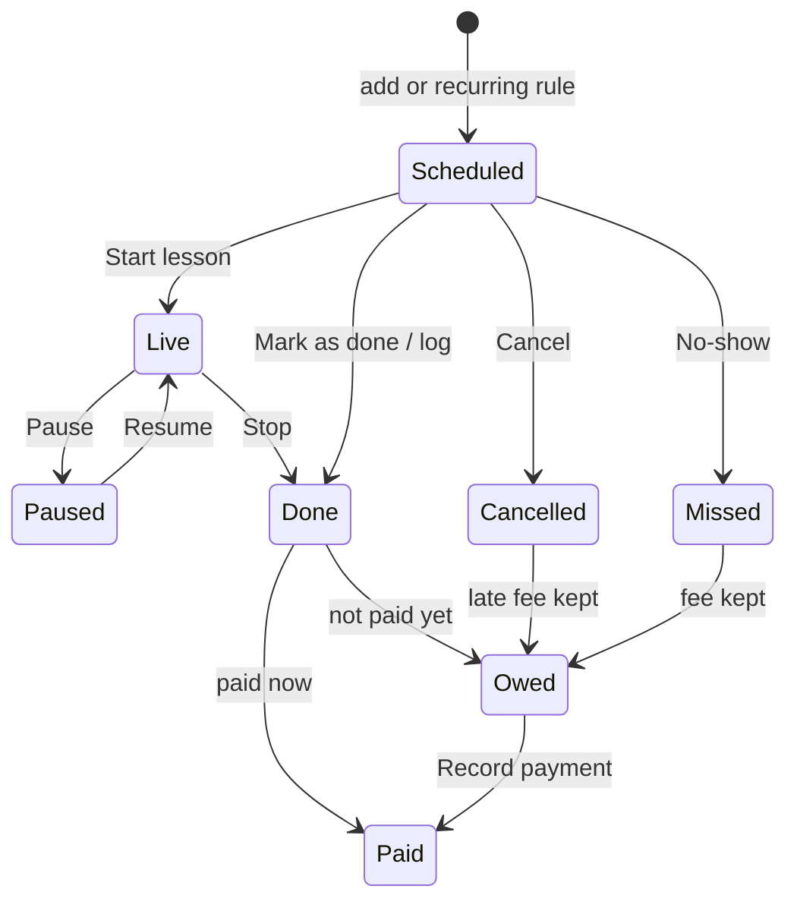

# Tutora — Product documentation (v1)

Oct 26, 2026 · @Victor

## Overview

Tutora is an offline-first mobile app that lets a teacher see, in one place, what they teach today, who owes them money, and how much they have earned this month. Version 1 runs on Android (iOS later from the same codebase), keeps all data on the phone in SQLite, and backs up by exporting a JSON file (full backup) or an Excel spreadsheet (readable report) to Google Drive or any cloud app.

**Who it is for**

- Private tutors who charge per hour or per lesson and need to track who paid.
- School and university teachers who juggle fixed timetables across several institutions.
- People who do both: a school salary plus private students on the side.

**v1 scope**

- Weekly schedule with recurring and one-off classes.
- Students, groups and institutions with their own rates.
- Live earnings: a lesson timer that shows money earned second by second for hourly lessons.
- Payments and pending balances per student.
- Monthly earnings dashboard.
- Local SQLite storage, JSON backup and restore, Excel (.xlsx) export, share to Google Drive.

**Not in v1**

- Accounts, login, cloud sync or a backend.
- Publishing to the Play Store or App Store (installed by APK only).
- Student-facing features, invoicing, tax reports.
- Multiple devices sharing the same data.

## Features

Nine must-have areas make up v1. Every lesson can be entered by hand or by the live timer, so a teacher can use Tutora purely as a schedule and earnings manager and never touch the timer.

| Area | What the teacher can do | Priority |
| --- | --- | --- |
| Schedule | See the day and week, add recurring classes (weekly, every 2 weeks) or one-off lessons, drag to reschedule, mark a class as done, cancelled or missed | Must |
| Manual entry and editing | Create, edit or delete any class by hand; log a lesson that already happened (date, start time, real duration, value) without ever using the timer; mark a scheduled class as done with one tap using its planned duration, or adjust the minutes first | Must |
| Students and groups | Keep a list of private students and school classes, with contact, rate, notes and color tag; link each student to one or more places, so a new class pre-selects the student's place, picking a place narrows the student list, and each place lists its students | Must |
| Places (templates) | Register each place once (school, salinha, cursinho, student's home, online) as a template: type, address, default duration, rate, who pays you (the place or the student), the place's commission, travel fee and pay cycle. Picking a place when adding a class pre-fills all of it, and money a place owes you is tracked like a student's balance. Two places come built in, Casa do Aluno and Online / Remoto, each with a default price set during first-run setup; students linked to a place inherit its price unless they have their own, and any class can still be edited | Must |
| Live earnings (optional) | Start a timer when a lesson begins; the screen shows elapsed time and money earned, updating every second; stop or pause; the final amount is saved to the lesson. Can be turned off in Settings for teachers who only manage the schedule | Must |
| Payments | Record payments (cash, Pix, transfer), see pending balance per student, mark lessons as paid in bulk, prepaid lesson packages, optional late-cancellation and no-show fees | Must |
| Earnings dashboard | Today, this week and this month earned vs. expected, school salary and formal jobs counted alongside private lessons, with a filter for all, private lessons, or school and formal job, and a 6-month trend; works the same whether lessons came from the timer or manual entry | Must |
| Reports per student or place | Pick a student or a place and a date range (this month, last month, 3 months or custom dates) to see lessons, hours, total, paid and owed; export it as a PDF to send to the student, parent or salinha, or as Excel, or as a short text for WhatsApp | Must |
| Backup | Full backup as a JSON file and restore from it; export an Excel spreadsheet (.xlsx) with one sheet each for lessons, payments, students, places and a monthly summary, filtered by period; share either file to Google Drive or any app via the system share sheet; optional automatic backup (daily, weekly or monthly) to a folder chosen once, such as a Google Drive folder, keeping the last few copies | Must |
| Calendar sync | Copy classes into Google Calendar, Outlook or a local calendar through the phone's own calendar, and optionally show other appointments as busy time on the Agenda; export an .ics file as a fallback | Should |
| Themes and customization | 4 themes (Quadro-negro, Caderno azul, Biblioteca, Giz pastel), each with light, dark or follow-the-system; pick any color (presets, a hex code, or hue, intensity and brightness sliders) for each part of the app: header, main buttons, highlight button, earnings numbers, background, cards and active menu; normal or large text | Should |
| Reminders | Local notification before each class and a weekly "who still owes you" summary | Should |
| Lesson notes | Write what was covered and homework given, per lesson | Should |

**How earnings are calculated**

- *Per hour:* amount = rate per hour × minutes taught ÷ 60, rounded to cents. While the timer runs this is recomputed every second, so the number visibly ticks up.
- *Per lesson:* a fixed price, counted when the lesson is marked done.
- *Package:* the student prepays N lessons; each completed lesson consumes one, and the app warns when 1 is left.
- *School salary:* a fixed monthly amount spread across the month. It counts in the Earnings totals, and the type filter separates school and formal job from private lessons. Places of type school or cursinho count as school and formal job by default; salinhas, students' homes and online count as private lessons.
- Expected earnings = all scheduled lessons in the period at their rate; earned = completed lessons; received = payments actually recorded.

*Place templates:* when a place pays you (e.g. a salinha paying R$ 60/h, settled monthly), the lesson's value is owed by the place, not the student, and shows under that place's balance. When the student pays and the place keeps a commission (e.g. 30% of R$ 100/h), earned = rate × (1 − commission), so the dashboard shows what you actually keep. Price order for a class: its own value if edited, otherwise the student's own price for that place, otherwise the place's default price. At Casa do Aluno a travel fee is added per lesson: asked in each class when it varies (the last value is suggested), a fixed amount, or nothing.

*Cancellation and no-show fees:* a default rule in Settings sets the notice window (2, 12, 24 or 48 hours) and what to charge for a late cancellation and for a no-show (50%, 100% or a fixed amount). Each student or place can follow the default, use its own rule or never charge. When a class is marked Cancelled inside the window, or Missed, Edit class suggests the fee and the teacher keeps or waives it; a kept fee counts as earned and adds to the student's or place's balance.

*Currency:* every amount is in reais (R$). The app language changes only how amounts are written (R$ 1.234,56 in Portuguese, R$1,234.56 in English), never the amount. Other currencies and exchange rates are not in v1.

## Screens

The app has five tabs in a bottom bar (Today, Schedule, Students, Places, Earnings) plus a full-screen live lesson view; Settings opens from a gear icon on Today. Students and Places are separate tabs but linked: a student shows its places and a place shows its students, and tapping one opens the other.

| Screen | Reached from | What it shows |
| --- | --- | --- |
| Today (home) | Tab 1 | Greeting, today's earnings card (earned vs. expected), next class with a Start button, the day's class list, pending payments alert |
| Schedule | Tab 2 | Week strip with dots per day, day timeline with colored class blocks, switch to week grid, + button to add a class |
| Live lesson | Start on any class | Big timer, money earned ticking up, rate, student name, pause/stop, quick note field |
| Students | Tab 3 | Search, filter (private / school), cards with rate, next class and balance owed |
| Student detail | Tap a student | Full picture first: linked places, balance, lessons this month, rate, next and recent lessons, payments; buttons for Record payment, Report and New lesson; Editar opens the edit form, whose main section is "Where the lessons happen and how much they pay": how the student is charged (per hour, per lesson or package), then one card per linked place with a star for the default place (pre-selected in New lesson), a remove button, and a Place price / Custom switch with a − / + stepper for this student's own price there. Places that pay you directly (a salinha or cursinho) show what the place pays instead of a student price. "+ Link to another place" adds a place inline |
| Earnings | Tab 5 | Filters (period: month, quarter or year with ‹ › to move; type: all, private lessons, school and formal job), one summary card (earned, received, to receive, with a bar), a "Where it came from" list ranked by value that opens each student or place, and a Relatório button for the full earnings report as PDF or Excel |
| Settings | Gear on Today | Grouped list. General: App language at the top (Português / English, changes only texts and dates, with a sample of each format under its option), then Appearance, Calendar sync. Your data: Backup and spreadsheet (automatic or manual, .json and .xlsx, restore, recent backups). Lessons and charging: Cancellations and no-shows (default fee rule), live timer on/off, reminders |
| Add / edit class | + button, tapping a class, or Mark as done | Two modes: Schedule (future class, repeat rule) or Log a lesson given (past date, real duration, value computed as you type, paid yes/no). The same screen opens pre-filled to edit any class or to mark it done |
| Record payment | Student detail or alert | Amount, method, date, which lessons it covers |

Settings opens two sub-screens. **Appearance** has a live preview, the theme list, light/dark/system, custom main and accent colors and text size. **Calendar sync** has an on/off switch, the target calendar (Google, Outlook or this device only), a busy-time option, whether to include the price in the event, and .ics export.

**Places** is tab 4. It lists the built-in places (Casa do Aluno, Online / Remoto) and then your own, each with its default price, how many students are linked and what it owes you. **Edit place** sets name, address, type, who pays, the rate or commission, the pay cycle and the default duration, with a live preview of what a 60-minute lesson there earns. **Add / edit class** shows the places as chips; picking one fills in rate and duration.

**Detail first, then edit:** tapping a class, a student or a place always opens its detail view with the full picture. Each detail view has an **Editar** button in the top right that opens the edit form, so editing is one deliberate step. Lesson detail shows time, duration, value, who pays, student, place, notes and the student's balance, with Mark as done and Start lesson. Student detail shows the places the student is linked to, and Place detail lists the students linked to it with a + Ligar aluno button. Both show balance, this month's lessons, rate, recent lessons and payments, with Record payment, Report and New lesson.

**Reports:** the **Relatório** button on Earnings builds the full earnings report for the period and type selected on screen, choosing PDF or Excel and what to include (breakdown by student and place, lesson list, payments). The earnings PDF has the totals, a table by student and place with lessons, hours, earned and owed, and a 6-month trend. A report for one student or one place (schools included) opens from **Report** on its detail view; it has By student / By place, period chips with From and To dates, and equal **PDF** and **Excel** buttons plus a copy-as-text option. For a school on a monthly salary it lists the days and classes taught and counts the salary per month.

**Edit class** opens from Editar on the lesson detail. It shows student, place, date, start time, duration and value; a status of Scheduled, Done, Cancelled or Missed; whether changes apply to this class only or this and the following ones; notes; and Start lesson, Save and Delete.

**Navigation map:** the mockup canvas opens with a map of the five tabs plus Settings and every screen under them, each labeled with the button that opens it, with the student and place links marked. The rows below follow the same order, one row per tab.

## User flows

The core loop is one lesson moving from the schedule to money in hand; the other flows are short and linear.

Paused is a timer state of a live lesson (stored as timestamps), and Owed and Paid are derived from payments; the stored `status` column holds scheduled, live, done, cancelled and missed.

The timer is optional: any lesson can be marked done from the schedule with its planned duration (editable), or logged by hand afterwards. Pausing stops the counter without losing time already earned.

**First launch**

1. First-run setup in four skippable steps: language; how you teach (private lessons, school or formal job, salinha or cursinho); default prices for Online / Remoto and Casa do Aluno, and whether travel varies per class, is fixed, or is not charged; automatic backup folder and class reminders.
2. Enter your name and default hourly rate.
3. Optionally add your first student or school, or skip to an empty Today screen.

**Add a recurring class**

1. Tap + on Today or Schedule.
2. Pick a student or a school group (or create one inline). Their linked place is pre-selected and only their places are offered; if you pick a place first, the student list narrows to that place's students.
3. Set weekday, time, duration and repeat rule.
4. Confirm the rate (pre-filled from the student) and save; the next 8 weeks appear on the schedule.

**Log a lesson without the timer**

1. Tap + and choose Log a lesson given (or tap a past class on the schedule).
2. Pick the student, date, start time and real duration; the value is calculated as you type (e.g. 90 min at R$ 120/h = R$ 180,00) and can be overridden.
3. Mark it paid now or leave it as owed, then save; Today, Earnings and the student balance update immediately.

**Mark a scheduled class as done**

1. Tap the class on Today or Schedule.
2. Tap Mark as done; the planned duration is used, or adjust the minutes first.

**Edit or move a class**

1. Tap any class, edit date, time, duration, rate or student, and save.
2. For a recurring class, choose This class only or This and following.

**Sync classes with Google Calendar or Outlook**

1. Settings, then Sync calendar, and turn it on; the phone asks for calendar permission once.
2. Pick the target: Google, Outlook (any account already on the phone) or this device only.
3. Tutora creates a "Tutora – Aulas" calendar there and keeps the next 8 weeks of classes in it; any change in Tutora updates or removes the event.
4. Optionally turn on Show other appointments, so personal events appear as grey busy blocks on the Agenda.

**Register a salinha as a template**

1. Students, then Locais, then +.
2. Name it, choose type Salinha, and set who pays: the place (e.g. R$ 60/h, settled monthly) or the student (e.g. R$ 100/h with 30% for the place).
3. Save; from now on, choosing this place in Add class fills in the rate, duration and payer.
4. At month end, open the place and tap Record payment to settle everything it owes in one go.

**Send a monthly report to a student or salinha**

1. Open the student or the place (from the Students or Places tab, or a row on Earnings) and tap Report.
2. Pick the period: This month, Last month, 3 months, or set custom From and To dates.
3. Check the totals, then tap Generate PDF; the share sheet opens so you can send it on WhatsApp or email, or save it to Drive.

**Record a payment**

1. Open the student from the Students tab or the pending-payments alert on Today.
2. Tap Record payment; the amount is pre-filled with the balance owed.
3. Pick the method and save; covered lessons turn green.

**Back up to Google Drive**

1. Settings, then Back up now (a .json file) or Export spreadsheet (an .xlsx file for a chosen period).
2. The share sheet opens; pick Google Drive (or any cloud app).
3. Or turn on automatic backup in Settings, Backup and spreadsheet: pick daily, weekly or monthly and choose a folder once (a Google Drive folder works). The last backup date is shown, with a warning after 14 days without one.

**Restore**

1. Settings, then Restore from backup, and pick the .json file.
2. Confirm that current data will be replaced; the app reloads.

## Data model

Ten SQLite tables plus one link table cover v1; money is stored as integer cents and times as ISO 8601 text so the JSON backup is a direct dump.

| Table | Key columns | Relations |
| --- | --- | --- |
| place | id, name, kind (school / salinha / course / student\_home / online), address, color, default\_duration\_min, rate\_type, rate\_cents, payer (place / student), commission\_pct, travel\_mode (varies / fixed / none), travel\_fee\_cents, is\_builtin, pay\_cycle (per\_lesson / weekly / monthly), monthly\_salary\_cents, job\_type (formal / private), fee\_rule (default / custom / none) | has many groups and lessons; can be the payer on payments |
| student | id, name, phone, email, rate\_type (hour / lesson / package), rate\_cents, fee\_rule (default / custom / none), color, notes, active | has many lessons, payments, packages; linked to places through student\_place (student\_id, place\_id, is\_default, rate\_cents: the student's own price there, empty to use the place's), many to many |
| group\_class | id, place\_id, name (e.g. "9th grade B"), subject, rate\_cents | belongs to place; has many lessons |
| schedule\_rule | id, student\_id or group\_id, weekday, start\_time, duration\_min, repeat (weekly / biweekly), starts\_on, ends\_on | generates lessons |
| lesson | id, rule\_id (nullable), student\_id or group\_id, place\_id, start\_at, end\_at, status (scheduled / live / done / cancelled / missed), rate\_type, rate\_cents, earned\_cents, travel\_fee\_cents, fee\_cents, fee\_waived, paid, source (manual / timer), calendar\_event\_id, notes | belongs to student or group; optional rule |
| lesson\_timer | lesson\_id, started\_at, paused\_ms, last\_resume\_at | one per live lesson, so the timer survives the app being closed |
| payment | id, student\_id or place\_id, amount\_cents, method (cash / pix / transfer / card), paid\_at, note | belongs to student; covers lessons via payment\_lesson |
| payment\_lesson | payment\_id, lesson\_id | links a payment to the lessons it pays |
| package | id, student\_id, lessons\_total, lessons\_used, price\_cents, bought\_at | belongs to student |
| settings | key, value | language (pt-BR / en), default rate, reminder minutes, theme\_id, theme\_mode (light / dark / system), custom\_colors (JSON map of element to hex, e.g. {"primaryBtn":"#7A2E3B"}), text\_scale, calendar\_sync\_on, calendar\_id, auto\_backup (off / daily / weekly / monthly), backup\_folder\_uri, backup\_keep, cancel\_window\_h, late\_cancel\_fee, no\_show\_fee, setup\_done, last\_backup\_at |

**Notes**

- Recurring classes are generated as real lesson rows 8 weeks ahead, so editing one week does not change the others.
- The live timer stores timestamps, not a running counter: earned = rate × (now − started\_at − paused\_ms). If the phone restarts mid-lesson the number is still right.
- Balance owed per student = sum of earned\_cents on done lessons − sum of payments. It is computed in a SQL view, not stored.
- The JSON backup is one file, `{"app":"tutora","schemaVersion":1,"exportedAt":"…","tables":{"student":[…],"lesson":[…],…}}`, so a newer app version can migrate an older backup. Restore replaces all data after a confirmation. The .xlsx export is read-only output for humans (money and dates formatted in the app's language and currency) and is never imported back.

## Visual identity

The palette borrows from a classroom: chalkboard green as the main color, pencil yellow for money and highlights, notebook-paper cream for backgrounds, and red-pen red only for what is overdue.

| Role | Name | Light | Dark | Used for |
| --- | --- | --- | --- | --- |
| Primary | Chalkboard green | #2E5E4E | #6FB39A | Header, primary buttons, active tab |
| Accent | Pencil yellow | #F2B33D | #F5C462 | Earnings numbers, live timer, highlights |
| Secondary | Notebook blue | #3D6FB4 | #7FA6DE | School classes, links, ruled-line details |
| Danger | Red pen | #D64545 | #EF7A7A | Overdue payments, cancel, delete |
| Success | Leaf green | #3E9D6B | #6CCB97 | Paid, completed lessons |
| Background | Notebook paper | #FAF7F0 | #141C19 | App background |
| Surface | Chalk white | #FFFFFF | #1E2925 | Cards, sheets |
| Text | Ink | #1F2A2E | #ECEFEA | Body text |
| Muted text | Graphite | #5C6A70 | #9AA8A2 | Labels, captions |

**Typography:** Nunito (rounded, friendly, very readable on small screens) for all UI text, with tabular figures for money so the live counter does not jitter as digits change.

**Shape and feel:** 16 px rounded cards, soft shadows, chunky 48 px touch targets, one color tag per student, and a subtle ruled-paper line pattern on empty states.

**Themes:** Quadro-negro is the default; three more themes keep the same layout and only swap colors. Each has a light and a dark variant, and the mode can follow the phone.

| Theme | Idea | Main (light / dark) | Accent (light / dark) | Background (light / dark) |
| --- | --- | --- | --- | --- |
| Quadro-negro | Chalkboard and pencil | #2E5E4E / #6FB39A | #F2B33D / #F5C462 | #FAF7F0 / #141C19 |
| Caderno azul | Blue notebook and orange highlighter | #2F5C9E / #7FA6DE | #F28C38 / #F5A766 | #F5F7FB / #121826 |
| Biblioteca | Leather books and gold lettering | #7A2E3B / #D9848F | #D9A441 / #E6BE6E | #FBF6EF / #1C1416 |
| Giz pastel | Pastel chalk, teal and coral | #2D7F86 / #7CC7CC | #F07C6C / #F59E91 | #F3F9F8 / #111B1C |

**Customization:** Appearance offers quick presets for the main and accent colors, plus a + swatch that opens **Suas cores**. There the teacher picks which part to paint (header, main buttons, highlight button, earnings numbers, background, cards, active menu) and sets any color with a hex code or with hue, intensity and brightness sliders, watching a live preview. Text on a colored button or header switches between white and dark by itself, and the screen shows the contrast ratio (good at 4.5:1 or more) so a custom color never makes text unreadable. In dark mode a custom color is lightened about 40% automatically. Restore resets all custom colors back to the theme. Red and green status colors stay fixed so paid and owed always read the same.

**Mockups:** all main screens, the live lesson timer (clickable) and this palette are on the [Tutora app screens](https://claude.ai/artifact/B8YKPsZff8TMJ7qLQd1JJY) canvas; their source is in [`docs/mockups/`](mockups/).

## Tech approach and open questions

Recommended stack: **React Native with Expo**, one codebase for Android now and iOS later, installed as an APK without any store.

- **Storage:** expo-sqlite, with a small migrations table so the schema can grow.
- **Export:** build the JSON backup in the app and the .xlsx with SheetJS (runs fully offline), save them with expo-file-system, and open the system share sheet (expo-sharing) so the teacher picks Google Drive, WhatsApp, email or any cloud app. No Google login is needed in v1.
- **Live timer:** computed from stored timestamps and re-rendered every second; a persistent notification shows the running amount while the app is in the background.
- **Reminders:** expo-notifications, scheduled locally. Languages: all text lives in pt-BR and English string files (i18next, with expo-localization picking the phone's language on first run), and money and dates are formatted with Intl for the chosen language, always in reais. Automatic backup: the teacher picks a folder once with Android's folder picker, which can be a Google Drive or OneDrive folder, and expo-background-task writes the JSON there on schedule and keeps the last N files; if Android skipped a run, the app does it the next time it opens. No Google sign-in is needed.
- **Speed:** all screens read from SQLite on device, so lists open instantly; v1 makes no network calls.
- **Alternative:** Flutter (with sqflite) would work equally well if you prefer Dart.

**Calendar sync without a backend:** expo-calendar writes events into the phone's own calendar store. Android and iOS already sync that store with Google or Outlook accounts, so classes reach the cloud calendar while Tutora itself stays offline. Sync is one-way in v1 (Tutora to calendar); edits made in Google Calendar are not pulled back, and other events are only read to show busy time. Direct Google/Microsoft API sync would need sign-in and is left for a later version.

**Themes:** colors live in a small token set per theme (main, accent, background, surface, text) loaded from settings at start-up, so switching theme or mode is instant and needs no restart.

**Reports and PDF:** report totals come from one SQL query over lessons and payments filtered by student\_id or place\_id and the date range. The PDF is rendered offline with expo-print from an HTML template that uses the active theme's main color, then shared with expo-sharing; large ranges paginate automatically.

**Decisions from your answers**

- [ ] Language and currency: language is Portuguese (pt-BR) or English and never changes an amount. v1 is reais only; USD and exchange rates are out (constitution rule 9).
- [ ] School salary: counts in Earnings together with private lessons, with a filter for private lessons vs school and formal job.
- [ ] Cancellation and no-show fees: added as an optional rule, off by default for new users, with a per-student override.
- [ ] Name: the app is called Tutora ("Tutora – Controle de aulas").
- [ ] Backups: automatic (daily, weekly or monthly to a chosen folder) as well as manual.
